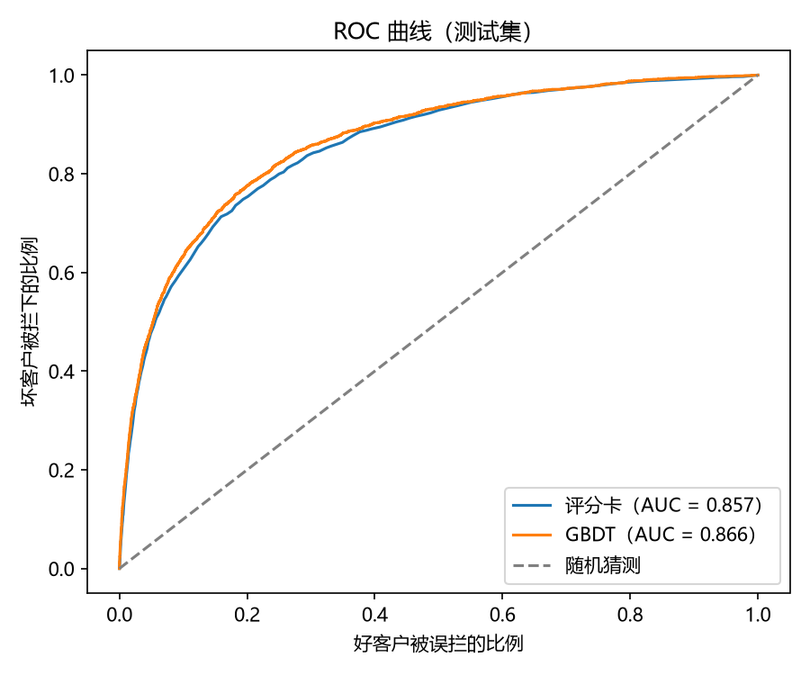
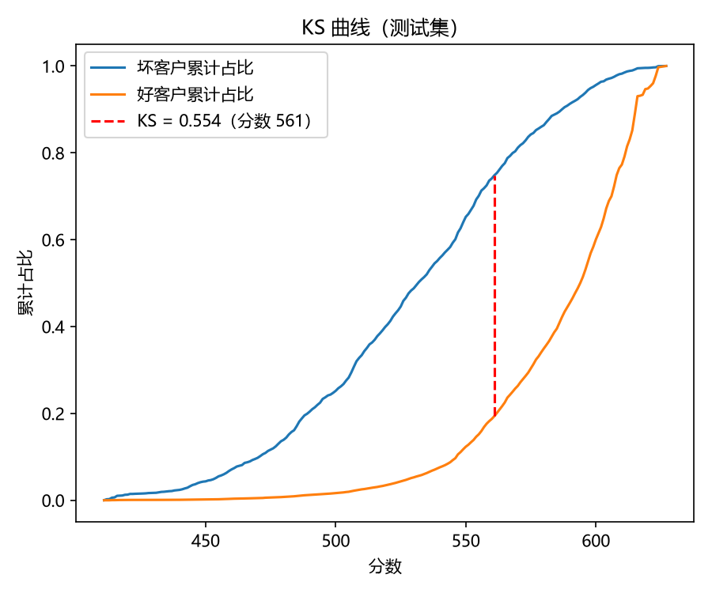
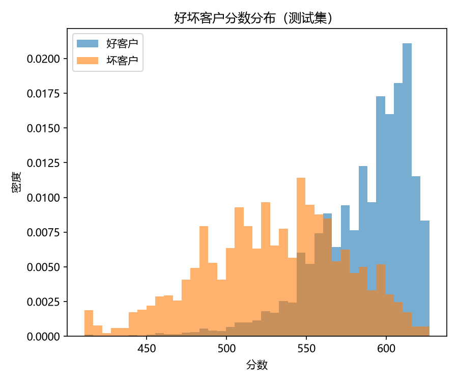

# 信用评分卡建模（Give Me Some Credit）

基于 Kaggle「Give Me Some Credit」数据集（约 15 万条借款人记录），完整复现银行申请评分卡的开发流程：

**数据诊断 → 清洗 → 分箱与 WOE/IV → 逻辑回归 → 分数转换 → 评估与分数线模拟**，并与梯度提升树（GBDT）做对比。

预测目标：借款人未来两年内是否出现 90 天以上的严重逾期。

---

## 结果

| 指标（测试集） | 评分卡（逻辑回归） | GBDT |
|---|---|---|
| AUC | 0.857 | 0.866 |
| KS | 0.555 | 0.576 |
| 可解释性 | 每个变量每一段的得分都可见 | 黑箱，需额外工具解释 |

- **无过拟合**：训练集与测试集 AUC 分别为 0.8574 和 0.8567；分数分布 PSI 为 0.0003。
- **排序能力**：按分数等分十组，坏客户比例从最低分组的 36.0% 单调下降到最高分组的 0.5%；**得分最低的 10% 客户覆盖了全部坏客户的 54%**。
- **分数线模拟**：分数线设为 560 分时，通过率 78%，通过人群的坏账率从 6.7% 降到 2.3%，拦下 74% 的坏客户。

---

## 关键发现与处理

清洗之前，先用 SQL 诊断每类问题数据背后的风险，再决定怎么处理：

1. **逾期次数中的 96 / 98 是特殊编码**：两年内不可能逾期 98 次，且三列逾期变量中恰好是同一批 269 人。这批人坏账率 54.7%，是正常人群的 8 倍。处理：作为缺失值单独分箱，而不是删除。
2. **缺失本身带有信息**：收入缺失人群的坏账率（5.6%）反而低于有收入人群（7.0%）。处理：不填补，单独分箱。
3. **收入缺失时，负债比并不是比率**：这部分 debt_ratio 的中位数为 1159（有收入人群为 0.3），实际记录的是月供金额。处理：设为缺失。
4. **额度使用率大于 10 是数据错误**：这批人坏账率 7.1%，接近平均水平；若真是十倍透支，风险应远高于使用率 1–2 的人群（40.1%）。处理：设为缺失。
5. **自动分箱需要人工检查**：决策树分箱要求每箱至少占 5% 的样本，而逾期 60–89 天的人只占约 4.9%，因此没能被单独切出。人工分箱后，该变量的 IV 从 0.04 升至 0.58。
6. **单调性调整**：合并收入、负债比中"拐弯"的相邻分箱，使风险随变量单调变化；房贷数量、账户数量保留有业务含义的 U 型关系。
7. **系数方向检验**：open_lines 进入模型后系数为负（与其他变量信息重叠），剔除后重新拟合，所有系数均为正。

---

## 评分卡设定

- 基准分 600 分，对应好坏比 50 : 1
- PDO = 20：好坏比每翻一倍，分数加 20 分
- 每一箱的得分 = −B × 系数 × WOE，其中 B = PDO / ln2

最终入模 9 个变量。完整评分卡在运行 `step4_model.py` 后生成于 `data/scorecard.csv`。

---

## 项目结构

| 文件 | 内容 |
|---|---|
| `step1_eda.py` | 读入数据，用 SQL 查看样本量、坏客户比例、缺失值和异常值 |
| `step2_clean.py` | 诊断问题数据的风险，清洗，按 7 : 3 分层抽样划分训练集和测试集 |
| `step3_woe_iv.py` | 决策树分箱 + 人工调整，计算 WOE 和 IV |
| `step4_model.py` | WOE 编码、相关性筛选、逻辑回归、系数方向检验、生成评分卡 |
| `step5_evaluate.py` | AUC / KS、十分位表、PSI、分数线模拟、与 GBDT 对比、画图 |

## 如何运行

1. 从 [Kaggle](https://www.kaggle.com/c/GiveMeSomeCredit/data) 下载 `cs-training.csv`，放入 `data/` 文件夹
2. 安装依赖：`pip install -r requirements.txt`
3. 依次运行 `step1_eda.py` 到 `step5_evaluate.py`

## 数据来源

Kaggle 比赛 [Give Me Some Credit](https://www.kaggle.com/c/GiveMeSomeCredit)。按照比赛规则，数据文件不包含在本仓库中。
